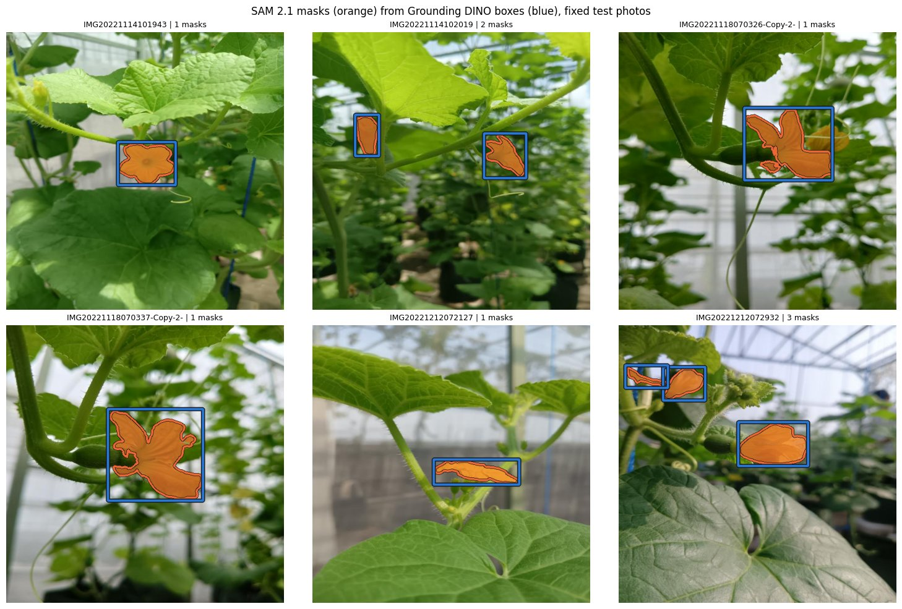
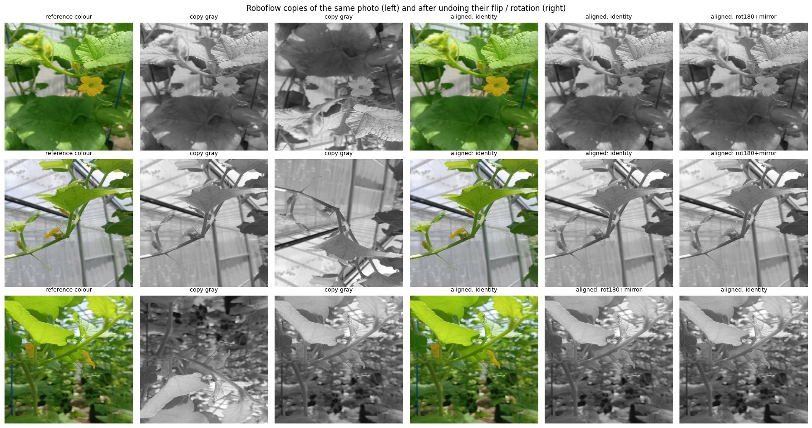
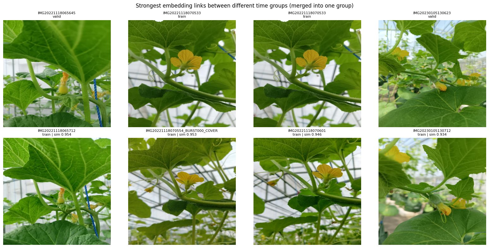
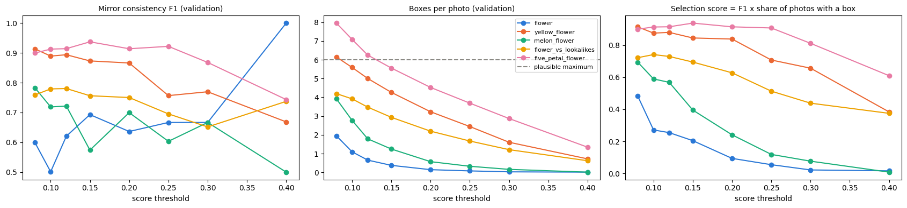
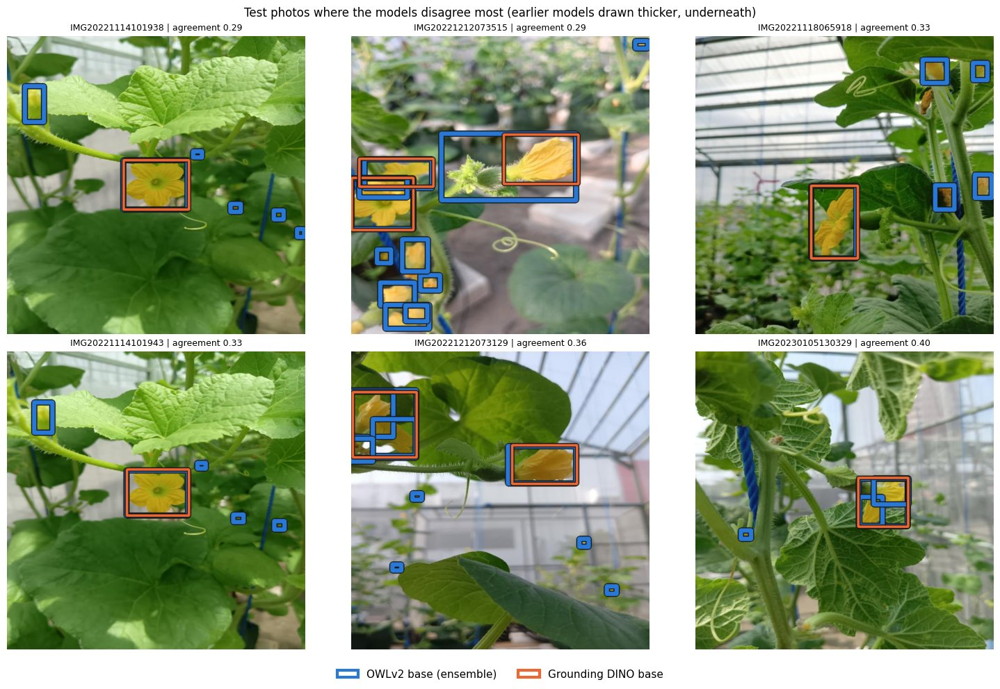

# Cantaloupe flowers: zero-shot pseudo-labels without ground truth

The [Cantaloupe flower dataset](#dataset-and-citation) ships images only, with no labels. This project labels the
flowers with three open-vocabulary models (OWLv2, Grounding DINO, SAM 2.1) and no training. Every model is scored
with label-free checks.

[](LICENSE)
[](https://www.kaggle.com/code/samirhossain2001/cantaloupe-flower-00-eda)
[](https://www.kaggle.com/datasets/samirhossain2001/cantaloupe-flower-datasets)
[](https://doi.org/10.17632/6cmwspbhdz.1)


## Headline result

Test split: 59 source photos. Prompts and thresholds were chosen on validation only. All runs used split
`a815ce5341f0`.

| Labels | Chosen prompt, threshold | Test mirror consistency (95% CI) | Copies colour vs gray F1 | Boxes per test photo | Params | T4 latency |
|---|---|---|---|---|---|---|
| OWLv2 base | "open yellow flower with five petals", 0.15 | 0.911 [0.880, 0.939] | 0.090 | 3.66 | 155.0 M | 109 ms |
| Grounding DINO base | "yellow flower", 0.30 | 0.951 [0.922, 0.976] | 0.534 | 2.03 | 232.3 M | 272 ms |
| SAM 2.1 masks (Grounding DINO boxes) | one mask per box | 0.971 [0.965, 0.976] (mask IoU) | n/a | 2.03 | 38.5 M | n/a |
| Consensus (both detectors agree) | box pairs with IoU >= 0.5 | 0.954 [0.914, 0.986] | n/a | 1.92 | n/a | n/a |

- **None of these numbers is an accuracy.** There are no ground-truth labels. The numbers measure stability, not
  correctness.
- **Mirror consistency:** each photo is also run mirrored left to right, and the boxes are matched at IoU 0.5.
- **Copies colour vs gray:** each grayscale Roboflow copy's own detections are matched against its colour original.
  It shows how much a model relies on colour.
- **Agreement:** the two detectors agree at F1 0.746 [0.680, 0.803] on the 59 test photos.
- **Ties:** on mirror consistency the 95% intervals of OWLv2 and Grounding DINO overlap, so the two are treated as tied.
- **The clear gap is grayscale:** 0.534 for Grounding DINO against 0.090 for OWLv2.



## Overview

- **Data:** 628 JPEGs (640x640) of greenhouse cantaloupe plants, from 311 source photos taken on 5 dates between
  2022-11-14 and 2023-01-05.
- **No labels:** the download has images only. The dataset was built for 3D pose estimation of floral organs (FloPE,
  arXiv 2503.11692), whose method starts from flower segmentation. So the missing annotations were most likely masks
  or keypoints.
- **Goal:** flower boxes and masks for every image, and a leakage-safe split for later supervised work.
- **What makes it hard:**
  - Each photo shows 1 to about 6 flowers, some small and blurred in the background.
  - Look-alikes include buds, young fruit, a yellow-spotted diseased leaf and a blue support rope.
  - 317 of the 534 train images are grayscale copies.

## Notebooks

Run them in order on Kaggle. Each link opens the executed notebook; its **Output** tab has the files it saved.

| # | Notebook (clean code in `notebooks/`) | Kaggle run and outputs | Device | Run time | Attach as input |
|---|---|---|---|---|---|
| 00 | `00_eda_and_split.ipynb`: image checks, Roboflow copies, bursts, leakage, grouped split | [cantaloupe-flower-00-eda](https://www.kaggle.com/code/samirhossain2001/cantaloupe-flower-00-eda) | CPU | 3.9 min | the dataset |
| 01 | `01_zs_owlv2.ipynb`: OWLv2 text prompts and image exemplars | [cantaloupe-flower-01-zs-owlv2](https://www.kaggle.com/code/samirhossain2001/cantaloupe-flower-01-zs-owlv2) | T4 | 4.6 min | dataset + 00 |
| 02 | `02_zs_gdino.ipynb`: Grounding DINO multi-phrase prompts | [cantaloupe-flower-02-zs-gdino-b](https://www.kaggle.com/code/samirhossain2001/cantaloupe-flower-02-zs-gdino-b) | T4 | 6.4 min | dataset + 00 |
| 03 | `03_masks_gdino_sam2.ipynb`: SAM 2.1 masks from the 02 boxes | [cantaloupe-flower-03-gdino-sam2-1](https://www.kaggle.com/code/samirhossain2001/cantaloupe-flower-03-gdino-sam2-1) | T4 | 1.1 min | dataset + 00 + 02 |
| 04 | `04_zs_comparison.ipynb`: comparison and consensus labels | [cantaloupe-flower-04](https://www.kaggle.com/code/samirhossain2001/cantaloupe-flower-04) | CPU | 0.2 min | dataset + 00 + 01 + 02 (+ 03) |

**Pseudo-labels in the outputs** (COCO json and YOLO txt, class 0 = flower):

| File | Notebook | Contents |
|---|---|---|
| `pseudo_owlv2.json`, `yolo_owlv2/` | 01 | OWLv2 boxes |
| `pseudo_gdino.json`, `yolo_gdino/` | 02 | Grounding DINO boxes |
| `pseudo_gdino_sam2.json`, `yolo_gdino_sam2/` | 03 | masks as polygons and YOLO segmentation |
| `pseudo_consensus.json`, `yolo_consensus/` | 04 | boxes found by both detectors |

## Data

The facts below come from the Kaggle run of notebook 00.

| Item | Value |
|---|---|
| Images / source photos | 628 / 311 (official split: train 534, valid 62, test 32) |
| Image size | 640x640 for every image |
| Roboflow copies | train: 117 photos x2 and 100 photos x3; valid and test: 1 copy each |
| Grayscale images | train 317 of 534; valid 0; test 0 |
| Copy transforms | all 317 copies aligned to their colour original: 154 identical, 163 flipped vertically |
| Exact or near duplicates across photos | 0 |
| Time between consecutive photos | median 9 s; 95% under 55.2 s |



**The official split leaks.** Photos taken seconds apart show the same plant, yet they sit in different official
splits: 120 consecutive pairs 20 s or less apart are split this way. Notebook 00 fixes this in four steps:

1. **Time groups:** chain photos 20 s or less apart, giving 67 groups.
2. **Embedding links:** join groups from the same date whose ResNet-50 embeddings are more similar than 99.9% of
   different-date pairs (threshold 0.913). That makes 27 links and leaves 50 groups.
3. **Check:** 29 of those 50 groups spanned more than one official split, covering 269 of the 311 photos.
4. **Re-split:** whole groups go to train / validation / test at 0.6 / 0.2 / 0.2, balanced per date. The result is
   **191 / 61 / 59 photos** (377 / 117 / 134 images), with every capture date in every split.



## Method

- **Models, all zero-shot, run through Hugging Face `transformers` 5.17.0:**

  | Model | Checkpoint |
  |---|---|
  | OWLv2 | `google/owlv2-base-patch16-ensemble` |
  | Grounding DINO | `IDEA-Research/grounding-dino-base` |
  | SAM 2.1 | `facebook/sam2.1-hiera-small` |

- **Prompts**, chosen from the look-alikes in the photos:
  - `flower`
  - `yellow flower`
  - `melon flower`
  - `open yellow flower with five petals`
  - `yellow flower` scored against `flower bud`, `small green fruit` and `leaf`: a box counts only if the flower
    phrase is its best match.
- **Image exemplars (OWLv2):** the 4 top-scoring train flowers become an image query. It was not selected: at the
  thresholds allowed by the guard below, its best mirror F1 on validation was 0.885, against 0.937 for the text
  prompt.
- **Selection:** each prompt runs once on validation, and thresholds are applied afterwards. The winner maximises
  mirror F1 x share of photos with a box. Settings with more than 6 boxes per photo on average are ruled out, since
  the photos show at most about 6 flowers.
- **Box filters, in order:**
  1. Drop boxes covering more than half of the image.
  2. NMS at IoU 0.5.
  3. Drop a box that covers 90% or more of a higher-scoring box.
  4. Keep at most 30 boxes per image.
- **Labels on Roboflow copies:** each photo's colour original is labelled. Its grayscale / flipped copies get the same
  boxes and masks through the flip found in 00, so all copies of a photo agree.

<details><summary>Configuration</summary>

Every setting is in the `CFG` dataclass in the configuration cell of each notebook: prompts, threshold grids,
`MIN_SCORE` 0.05, `NMS_IOU` 0.5, `CONTAIN_FRAC` 0.9, `MAX_BOX_AREA` 0.5, `MAX_MEAN_BOXES` 6, `MATCH_IOU` 0.5, seed 42,
and the dataset path `DATA_DIR`.
</details>

## Metrics

| Metric | Definition |
|---|---|
| **Mirror consistency F1** (headline) | the photo and its left-right mirror are both run; boxes are mapped back and matched one to one at IoU 0.5; F1 per photo, then averaged |
| Copy consistency F1 | the same between a photo's Roboflow copies, using each copy's own detections; it measures reliance on colour |
| Mask mirror IoU | IoU between a box's mask and the mask of the same box in the mirrored pass |
| Box agreement F1 | one-to-one match between the two detectors' boxes on the same photo |

Every interval is a 95% bootstrap interval over photos (1,000 resamples).

## Results

**Prompt wording matters.** For OWLv2 on validation, `flower` alone finds almost nothing above
threshold 0.2. `yellow flower` and `open yellow flower with five petals` find 3 to 8 boxes per photo at 0.08-0.2.
For Grounding DINO, four of the five prompts stay between mirror F1 0.93 and 0.96 at thresholds 0.2-0.35.



**In the inspected test photos, Grounding DINO gives fewer and cleaner boxes; OWLv2 finds more but noisier ones.**
This comes from looking at the figures; without labels, precision was not measured.
- Grounding DINO gives 2.03 boxes per test photo and OWLv2 gives 3.66.
- The photos where they disagree most show two kinds of extra OWLv2 box:
  - **Noise:** tiny boxes on the rope and leaf spots.
  - **Real flowers Grounding DINO misses:** small or background flowers.
- The consensus keeps boxes found by both. It has 94% as many boxes per test photo as Grounding DINO (1.92 against
  2.03), so it drops OWLv2's noise but also those extra real flowers.



**Masks are stable.**
- SAM 2.1 produced a mask for every Grounding DINO box: 769 masks on the 311 colour originals, copied to the 317
  Roboflow copies, with none empty.
- Given the same box, the mirrored pass reproduces the mask at IoU 0.971 on test.
- Typical masks fill about half of their box. Their own bounding box matches the input box at IoU 0.85-0.95 (lowest
  0.71).

## Quick start

1. Import the five notebooks from `notebooks/` into Kaggle, or fork the runs linked above.
2. Add the dataset [samirhossain2001/cantaloupe-flower-datasets](https://www.kaggle.com/datasets/samirhossain2001/cantaloupe-flower-datasets)
   as an input. The notebooks look in `/kaggle/input/datasets/samirhossain2001/cantaloupe-flower-datasets/Cantaloupe flower datasets`
   first and otherwise search every attached input.
3. Settings: GPU T4 for 01 to 03, Internet on (model weights and the `transformers` pin). No Hugging Face token is
   needed.
4. Run 00 to 04 in order, attaching the outputs listed in the Notebooks table.

To try a notebook quickly, set `SMOKE = True` in its configuration cell: it then runs on a few photos only.

## Reproducibility

- Seed 42 throughout. Notebook 00 gave the same `split_id` (`a815ce5341f0`) on Kaggle as in a local run, and every
  later notebook checks it.
- Test is scored once, after the prompt and threshold were fixed on validation.
- Zero-shot inference has no training randomness. Scores can differ slightly between GPU (fp16) and CPU.
- The executed 00 predates two small helper functions added to the shared helper cell. 00 does not call them.

## Limitations

- **No ground truth:** nothing here measures precision or recall. No hand audit was done.
- **Stability is not correctness:** a model that boxes the same leaf spot in every pass scores as consistent.
- **The consensus trades recall for cleanliness:** it removes OWLv2's specks, but also real small flowers that only
  OWLv2 found.
- **Merged flowers:** two overlapping flowers sometimes get one box, and SAM 2.1 then masks mainly the front flower.
- **Stretched images:** the 640x640 images are stretched from phone photos, so shapes are slightly distorted.
- **One assumption in the split:** the embedding-link threshold treats photos from different dates as different
  scenes.
- **SAM 3 not used:** SAM 3 was the first choice for masks, but its weights are gated and access was not granted.
  SAM 2.1 from Grounding DINO boxes is the fallback.

## Dataset and citation

Images: Triet, Le (2025), "Cantaloupe flower datasets", Mendeley Data, V1, doi:
[10.17632/6cmwspbhdz.1](https://doi.org/10.17632/6cmwspbhdz.1). The Kaggle copy used here is
[samirhossain2001/cantaloupe-flower-datasets](https://www.kaggle.com/datasets/samirhossain2001/cantaloupe-flower-datasets).

```bibtex
@misc{triet2025cantaloupe,
  author    = {Triet, Le},
  title     = {Cantaloupe flower datasets},
  year      = {2025},
  publisher = {Mendeley Data},
  version   = {V1},
  doi       = {10.17632/6cmwspbhdz.1}
}
```

**Related work:**
- FloPE: Flower Pose Estimation for Precision Pollination, arXiv 2503.11692.
- Does Your VFM Speak Plant?, arXiv 2604.09920 (preprint, on prompt sensitivity for flower detection).
- Minderer et al., Scaling Open-Vocabulary Object Detection (OWLv2), NeurIPS 2023.
- Liu et al., Grounding DINO, ECCV 2024.

## License

The code in this repository is released under the [MIT License](LICENSE). The dataset and model weights keep their own
terms:

| Component | Terms |
|---|---|
| Dataset | see the [Mendeley Data page](https://data.mendeley.com/datasets/6cmwspbhdz/1) |
| OWLv2 `google/owlv2-base-patch16-ensemble` | Apache-2.0 |
| Grounding DINO `IDEA-Research/grounding-dino-base` | Apache-2.0 |
| SAM 2.1 `facebook/sam2.1-hiera-small` | Apache-2.0 |

## Author

Samir Hossain · [2001samirhossain@gmail.com](mailto:2001samirhossain@gmail.com)
